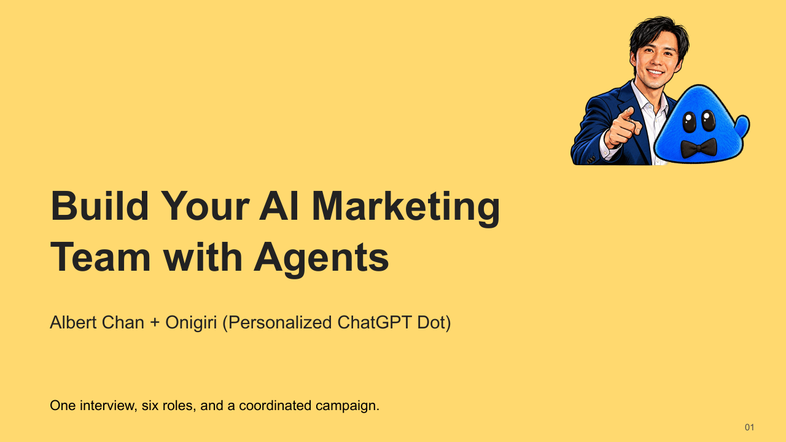
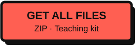
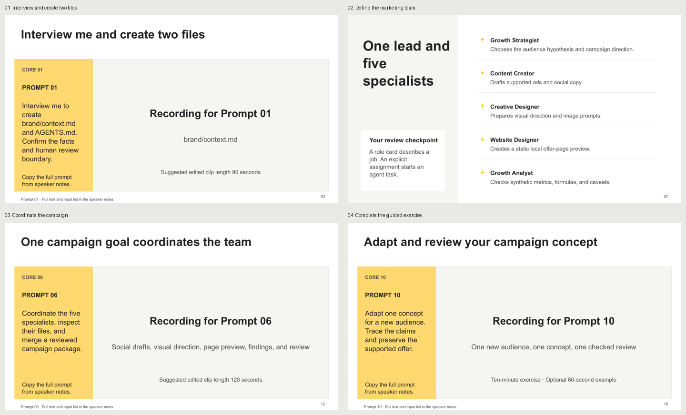

# Build Your AI Marketing Team with Agents

**One 60-minute class with a ten-minute guided exercise.** Interview AI to create your brand context and project instructions, then create a skill, define six roles, and coordinate a fictional marketing campaign.

## Begin with one interview

Open [Start here](START-HERE.md), create an empty project, and paste prompt 01. It asks questions and creates **brand/context.md** and **AGENTS.md**. The remaining prompts run **02 through 10 in teaching order**, matching the slides and workbook.

  
  
  

| Choose your route | Open this |
| --- | --- |
| Follow the class | [Starting guide](START-HERE.md) and [ordered prompts](prompts/README.md) |
| Read the complete lesson offline | [Learner workbook](downloads/learner-workbook.pdf) |
| Teach the session | [Google Slides](https://docs.google.com/presentation/d/1EY7U2ZDfHXPUsubG0SyrNJdkPEbLEOhQGgygsC7SWC0), [deck PDF](downloads/course-deck.pdf), and [speaking scripts](docs/instructor-notes.md) |
| Rehearse the interview | [Prepared Copper Cup answers](starter/interview-answer-card.txt) |
| Compare completed files | [Prepared campaign examples](examples/README.md) |

## The complete session

| Prompts | Create or demonstrate |
| --- | --- |
| 01 | Interview and two foundation files |
| 02–03 | Reusable ad skill and six marketing roles |
| 04–05 | Strategy, copy, visual direction, and visible handoffs |
| 06 | Coordinated social drafts, page preview, metric findings, and review |
| 07 | Onigiri through voice or chat, with written task results |
| 08 | A private campaign Page or structured document fallback |
| 09 | A decision-first brief and disabled routine proposals |
| 10 | A ten-minute audience adaptation and review exercise |

## Each agent owns an output

The Growth Strategist proposes a direction. The Content Creator drafts supported copy. The Creative Designer prepares visual direction and image prompts. The Website Designer creates a static local page. The Growth Analyst checks synthetic metrics and limitations. The Marketing Team Lead coordinates the assignments and returns a checked handoff and human decision.

Local Codex uses project instructions, skills, and local agent definitions. Work uses accessible files and explicit delegation. The class labels sequential role-based drafts when separate subagents are unavailable. [Read the session and capability notes](docs/session-guide.md).

## Use reference files after your attempt

The [starter folder](starter/) contains raw facts and an interview answer card. The [completed project](examples/completed-beginner-project/) shows prepared comparison files. The older [course-files project](course-files/README.md) retains advanced reference assets. Begin with your own empty project so the interview creates your foundation files.

Copper Cup Coffee and the campaign data are fictional. The Discovery Box contains three 100 g bags for USD 29 plus USD 5 shipping. Classroom outputs remain drafts and local previews. Sending, publication, schedules, image-generation charges, launch, spending, deletion, and permission changes require separate decisions.

## Instructor resources

The deck has **20 teaching slides plus four reference slides**. The teaching sequence totals **60 minutes**, including the **ten-minute exercise**. [Open the timing outline](docs/deck-outline.md), [full scripts and prompts](docs/instructor-notes.md), and [recording guide](recordings/README.md). Demo layouts retain a quarter-width prompt panel beside a three-quarter-width recording frame.

## Sources and preserved materials

The course adapts examples from Grace Leung and Riley Brown and uses the uploaded Leland event template. The October 15, 2026 revision keeps the interview short and includes medium and advanced demonstrations within the single session. [Read the full course sources](docs/sources.md). [Earlier tutorial materials](extensions/legacy-tutorial/README.md) remain available as references with their earlier numbering.
